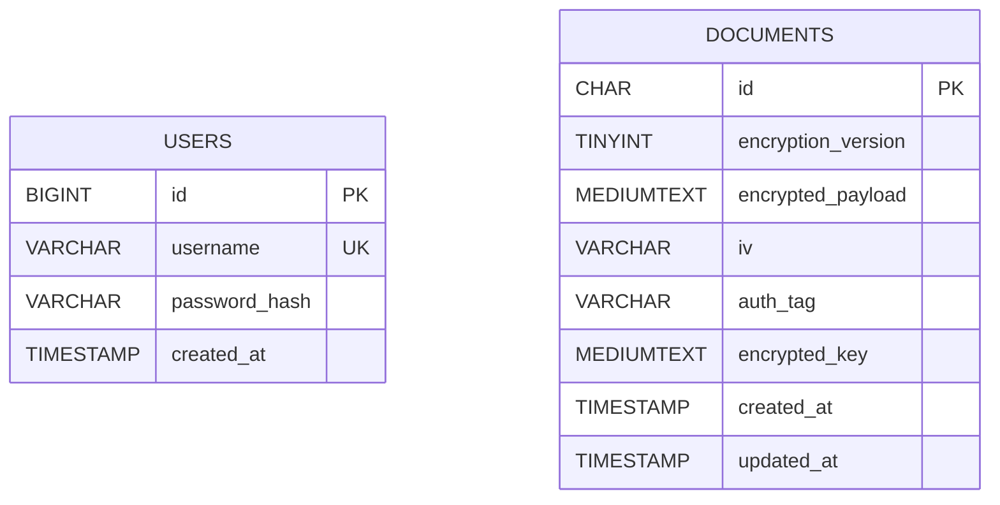

# Panduan Laporan Tugas

> Dokumen ini adalah bahan laporan yang perlu disesuaikan dengan identitas mahasiswa, nama mata kuliah, instruksi dosen, dan hasil pengujian yang benar-benar dijalankan.

## Judul

**Implementasi Hybrid Cryptography Menggunakan AES-256-GCM dan RSA-OAEP SHA-256 pada Sistem Informasi Manajemen Dokumen Berbasis Web**

## BAB I — Pendahuluan

### 1.1 Latar Belakang

Sistem informasi berbasis web menyimpan dan mengolah informasi yang dapat bersifat rahasia. Apabila isi dokumen disimpan langsung sebagai plaintext, pihak yang memperoleh akses tidak sah ke database berpotensi membaca informasi tersebut. Oleh karena itu, aplikasi ini menerapkan kriptografi pada konten dokumen sebelum data disimpan.

Aplikasi menggunakan pendekatan hybrid cryptography. Algoritma simetris AES-256-GCM digunakan untuk mengenkripsi payload dokumen karena efisien untuk data berukuran relatif besar dan menyediakan autentikasi integritas. Algoritma asimetris RSA-OAEP SHA-256 digunakan untuk mengenkripsi AES key sehingga AES key tidak disimpan secara terbuka.

### 1.2 Rumusan Masalah

1. Bagaimana menerapkan AES-256-GCM untuk mengenkripsi seluruh field konten dokumen?
2. Bagaimana menggunakan RSA-OAEP SHA-256 untuk melindungi AES key?
3. Bagaimana mengintegrasikan enkripsi dan dekripsi dengan operasi CRUD admin berbasis PHP dan MySQL?
4. Bagaimana menguji keberhasilan dekripsi dan mendeteksi perubahan ciphertext?

### 1.3 Tujuan

- Mengembangkan sistem informasi manajemen dokumen menggunakan PHP Native dan MySQL.
- Menerapkan AES-256-GCM pada judul, kategori, deskripsi, dan isi dokumen.
- Menerapkan RSA-OAEP SHA-256 pada AES key per dokumen.
- Memastikan ciphertext tidak dapat didekripsi ketika integritas data gagal.

## BAB II — Landasan Teori

### 2.1 Kriptografi Simetris

Kriptografi simetris menggunakan kunci rahasia yang sama untuk proses enkripsi dan dekripsi. Implementasi ini menggunakan Advanced Encryption Standard (AES) dengan ukuran kunci 256-bit dan mode Galois/Counter Mode (GCM). GCM merupakan authenticated encryption with associated data (AEAD), sehingga proses dekripsi juga memverifikasi authentication tag.

### 2.2 Kriptografi Asimetris

Kriptografi asimetris menggunakan pasangan public key dan private key. Public key digunakan untuk mengenkripsi AES key, sedangkan private key digunakan untuk membukanya. Implementasi ini menggunakan RSA dengan padding Optimal Asymmetric Encryption Padding (OAEP), hash SHA-256, dan MGF1 SHA-256.

### 2.3 Hybrid Cryptography

Hybrid cryptography menggabungkan kecepatan algoritma simetris dengan pengelolaan kunci algoritma asimetris. Konten dokumen dienkripsi menggunakan AES. AES key yang digunakan kemudian dienkripsi menggunakan RSA public key. Dengan demikian, database hanya menyimpan encrypted AES key dan ciphertext dokumen.

### 2.4 Teknologi

| Komponen | Teknologi |
|---|---|
| Backend | PHP Native 8.1+ |
| Database | MySQL 8+ / MariaDB yang kompatibel |
| Database driver | PDO MySQL |
| Symmetric encryption | AES-256-GCM |
| Asymmetric encryption | RSA-OAEP SHA-256 (MGF1 SHA-256) |
| RSA key pair | 3072-bit |
| RSA library | phpseclib 3.x |
| UI framework | Bootstrap 5.3.8 |

## BAB III — Analisis dan Perancangan

### 3.1 Aktor dan Use Case

Aktor aplikasi adalah Administrator. Use case administrator meliputi login, melihat daftar dokumen, menambah dokumen, melihat detail, mengubah dokumen, menghapus dokumen, dan melihat bukti ciphertext.

### 3.2 Alur Enkripsi

1. Administrator mengisi judul, kategori, deskripsi, dan isi dokumen.
2. Sistem membentuk payload JSON.
3. Sistem membuat AES key acak 256-bit dan IV acak 96-bit.
4. Sistem mengenkripsi payload dengan AES-256-GCM dan menghasilkan ciphertext serta authentication tag 128-bit.
5. Sistem mengenkripsi AES key menggunakan RSA public key dengan OAEP SHA-256 dan MGF1 SHA-256.
6. Sistem menyimpan ciphertext, IV, tag, encrypted AES key, versi enkripsi, ID, dan timestamp ke MySQL.

### 3.3 Alur Dekripsi

1. Administrator meminta detail dokumen.
2. Sistem membaca encrypted AES key dan ciphertext berdasarkan ID.
3. Sistem membuka encrypted AES key menggunakan RSA private key.
4. Sistem mendekripsi payload menggunakan AES-256-GCM, IV, tag, dan AAD.
5. Apabila authentication tag valid, sistem menampilkan plaintext pada halaman admin.
6. Apabila ciphertext, tag, IV, AAD, atau key tidak sesuai, proses dekripsi gagal.

### 3.4 Entity Relationship Diagram

Diagram berikut dapat ditempel ke editor Markdown yang mendukung Mermaid atau digambar ulang pada laporan:

Database mempunyai dua entitas:

- `users`: menyimpan akun administrator dan password hash.
- `documents`: menyimpan metadata serta komponen ciphertext dokumen.

Tidak ada foreign key dari `documents` ke `users` pada versi tugas ini karena data kepemilikan dokumen belum menjadi kebutuhan fungsional.

### 3.5 Struktur Penyimpanan Dokumen

| Kolom | Isi |
|---|---|
| id | UUID dokumen, dipakai sebagai AAD |
| encryption_version | Versi skema enkripsi |
| encrypted_payload | Payload JSON yang dienkripsi AES-GCM, base64 |
| iv | IV AES-GCM, base64 |
| auth_tag | Authentication tag AES-GCM, base64 |
| encrypted_key | AES key yang dienkripsi RSA-OAEP, base64 |
| created_at / updated_at | Timestamp operasional |

## BAB IV — Implementasi

### 4.1 Implementasi Login

Akun administrator dibuat melalui CLI. Password disimpan menggunakan `password_hash()` dan diverifikasi menggunakan `password_verify()`. Password tidak dienkripsi dua arah.

### 4.2 Implementasi AES-256-GCM

Setiap dokumen memperoleh AES key 32 byte dan IV 12 byte yang dibuat menggunakan `random_bytes()`. Authentication tag diset sepanjang 16 byte. ID dokumen digunakan sebagai Additional Authenticated Data (AAD) agar ciphertext terikat pada ID record yang benar.

### 4.3 Implementasi RSA-OAEP SHA-256

RSA public key mengenkripsi AES key. Konfigurasi OAEP menetapkan hash SHA-256 dan MGF1 SHA-256. RSA private key yang dilindungi passphrase hanya dibaca oleh backend ketika proses dekripsi diperlukan.

### 4.4 Integrasi CRUD

- Create: payload dienkripsi sebelum `INSERT`.
- Read: ciphertext didekripsi setelah autentikasi admin berhasil.
- Update: payload dienkripsi ulang menggunakan AES key dan IV baru.
- Delete: record ciphertext dihapus dari database.

### 4.5 Link Source Code

Isi setelah repository publik dibuat:

`https://github.com/USERNAME/simd-hybrid-cryptography`

Jangan mencantumkan link contoh ini sebagai repository aktif sebelum repository benar-benar tersedia.

## BAB V — Pengujian

Jalankan pengujian otomatis dengan `composer test`. Catat tanggal, versi PHP, versi phpseclib dari `composer show phpseclib/phpseclib`, versi database, dan hasil aktual saat pengujian dilakukan.

| No. | Skenario | Hasil yang diharapkan |
|---|---|---|
| 1 | Enkripsi lalu dekripsi payload | Plaintext hasil dekripsi sama dengan input |
| 2 | Periksa isi ciphertext | Judul dan isi plaintext tidak ditemukan di encrypted payload |
| 3 | Ubah satu byte ciphertext | Dekripsi gagal pada verifikasi GCM |
| 4 | Ubah ID record (AAD) | Dekripsi gagal |
| 5 | Gunakan private key yang salah | AES key tidak dapat dibuka |
| 6 | Versi enkripsi tidak dikenal | Dekripsi ditolak |
| 7 | CRUD melalui browser | Data berhasil dibuat, dibaca, diubah, dan dihapus |
| 8 | Akses halaman tanpa login | Dialihkan ke halaman login |

Masukkan screenshot halaman dashboard, form dokumen, detail dokumen, tampilan bukti ciphertext, dan struktur tabel MySQL. Jangan mengarang hasil pengujian; lampirkan output aktual.

## BAB VI — Penutup

### 6.1 Kesimpulan

Tuliskan kesimpulan berdasarkan hasil aktual, misalnya apakah seluruh operasi CRUD berjalan, apakah isi dokumen tersimpan sebagai ciphertext, apakah dekripsi mengembalikan plaintext, dan apakah perubahan ciphertext terdeteksi.

### 6.2 Saran

Pengembangan lanjutan dapat mencakup role-based access control, audit log, key rotation, backup key terenkripsi, pagination, dan deployment dengan HTTPS.

## Referensi Teknis

- PHP Manual, `openssl_encrypt`: https://www.php.net/manual/en/function.openssl-encrypt.php
- phpseclib 3.x RSA API: https://api.phpseclib.com/3.0/phpseclib3/Crypt/RSA.html
- phpseclib 3.x PublicKeyLoader API: https://api.phpseclib.com/3.0/phpseclib3/Crypt/PublicKeyLoader.html
- Bootstrap 5.3 documentation: https://getbootstrap.com/docs/5.3/
- NIST SP 800-38D, Recommendation for Block Cipher Modes of Operation: Galois/Counter Mode (GCM): https://csrc.nist.gov/pubs/sp/800/38/d/final
- RFC 8017, PKCS #1 v2.2: https://www.rfc-editor.org/rfc/rfc8017
